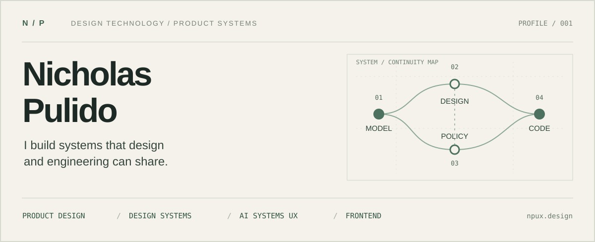

<p align="center">
  <a href="https://npux.design"></a>
</p>

<p align="left">
  <a href="https://npux.design"><strong>Portfolio</strong></a> &nbsp;·&nbsp;
  <a href="https://www.linkedin.com/in/nickpulido/">LinkedIn</a> &nbsp;·&nbsp;
  <a href="mailto:npulido@gmail.com">Email</a> &nbsp;·&nbsp;
  <a href="https://npux.design/notes">Writing</a>
</p>

### `> about`

I'm a product designer and design technologist working across **interaction design, design systems, frontend architecture, and AI-enabled products**.

I like the work between disciplines: turning unclear product behavior into an explicit model, building a reference implementation, and making the decisions repeatable in code. The goal isn't just a polished screen; it's a system that holds together when the product changes.

```text
NICHOLAS / SYSTEM PROFILE
──────────────────────────────────────────────────────────────────
  PRIMARY       Product design · Design engineering · Design systems
  CURRENT       Agentic interfaces · Governed AI · Design-to-code
  METHODS       Model → Contract → Reference → Validation → System
  LOCATION      Southern California
  WEB           npux.design
──────────────────────────────────────────────────────────────────
```

### `> selected work`

| Project | What it explores |
|:--|:--|
| **[REDTHREAD](https://github.com/npuxdev/redthread)** | Investigation workspaces where evidence, relationships, timelines, and agent-generated analytical instruments meet. *Repository currently private.* |
| **[SiteThread](https://github.com/npuxdev/sitethread)** | Location-aware coordination with an explicit, confirmed handoff. |
| **[UXIR](https://github.com/npuxdev/uxir)** | Research into schema-driven interactions and structured UI. |
| **[Page Notes](https://github.com/npuxdev/page-notes)** | Capture inline webpage feedback as developer-ready context and screenshots. |
| **[Design Products with AI](https://github.com/npuxdev/design-products-with-ai)** | A skill for translating product intent into coherent, buildable designs. |
| **[Agent Estimation Research](https://github.com/npuxdev/agent-estimation-research)** | Experiments into how well LLM agents estimate remaining work. |

**More product work** — [Flow Intelligence](https://npux.design) · [Enterprise Design System](https://npux.design) · [TROT Agent Operations](https://npux.design) · [PolicyPal](https://npux.design)

### `> working principles`

```text
01  MODEL FIRST            Give the product a shared source of truth.
02  EXPLICIT CONTRACTS     Make behavior and constraints inspectable.
03  REFERENCE BUILDS       Prove what static artifacts cannot resolve.
04  GOVERNED INTELLIGENCE Keep evidence, uncertainty, and control visible.
05  ENCODE WHAT REPEATS    Turn decisions into durable infrastructure.
```

---

<sub>Design + implementation are one continuous problem. <a href="https://npux.design">See the full portfolio →</a></sub>
